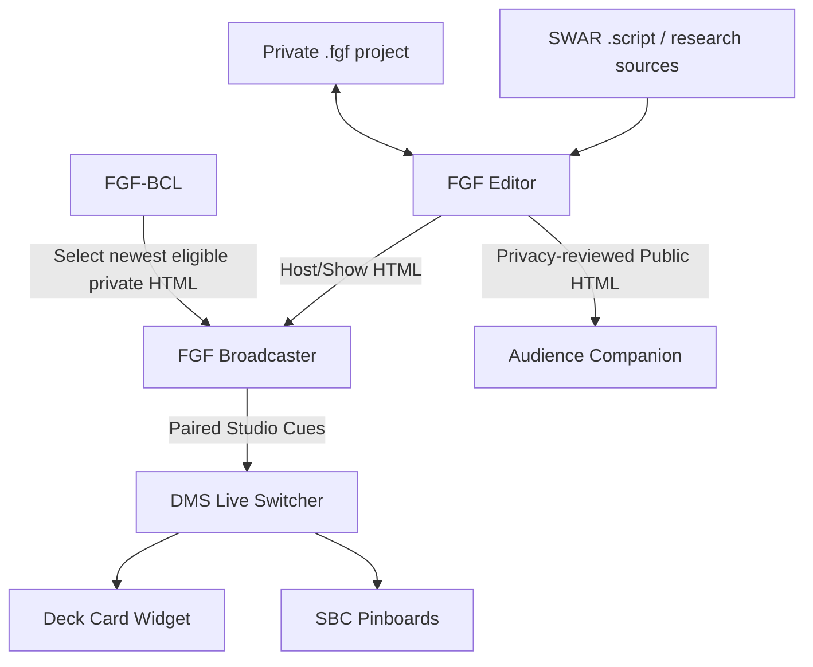

<div align="center">

# 📚 Field Guide Forge
### From research and scripts to an interactive show—and a linked studio.

**Local-first episode authoring • Evidence-driven presenter • OBS broadcaster • Public companion publishing**

[](#architecture) [](#run-the-editor) [](#fgf-bcl--the-newest-episode-launcher) [](#development-status)

**[Editor](#what-you-can-build) · [Quick start](#run-the-editor) · [Studio Cues](#studio-cues--paired-studio-automation) · [Broadcaster](#broadcaster-controls) · [FGF-BCL](#fgf-bcl--the-newest-episode-launcher) · [Privacy](#private-versus-public-output)**

</div>

---

## Meet FGF

**Field Guide Forge (FGF)** is an editor and exporter for interactive presentation pages, proof displays, script-driven show outlines and post-show companion guides. It was built around **3D Changes Perspectives** production workflows and the **DigiMancer Streamer Tools** family, but its local-first format is useful for other shows and projects.

A field guide can move from a private script and source-rich storyboard to two distinct destinations:

1. A **private host/broadcaster** HTML that follows the show, displays evidence and—with authorization—requests studio actions.
2. A **public-web companion** HTML that keeps the audience-facing material while omitting local automation cues and private studio connections.

> [!WARNING]
> Never mistake a private broadcaster export for a public episode companion. Review privacy, embedded image pixels, links and source material before publishing any generated HTML.

## What you can build

| Workspace | What it supports |
|:--|:--|
| Field Guide Editor | `.fgf` projects, visual pages, content blocks, colors and themed layouts |
| SWAR input | Import compatible `.script` files into a structured guide |
| Flow / Layout | Page navigation, storyboard grouping, multi-column, grids, tables and proof regions |
| Sources & evidence | Link-first proof displays, embedded media where supported, external-source fallbacks |
| Broadcast Studio | OBS-View and Full-Proof presentation styles, fullscreen stage, optional background |
| Studio Cues | Assign a Deck Card, pinboard, or QR/Full display change to page/source/block events |
| Publishing | Privacy-aware public HTML and show HTML exports, plus public-facing packaging tools |
| FGF-BCL | Native optional launcher to open the newest matching broadcaster episode |

## Architecture



The core editor is an HTML/CSS/JavaScript application. A small **local Python helper** provides a first-class app launch and a limited catalog of saved card names without granting arbitrary filesystem access to the browser. FGF-BCL is a separate **C++20/Qt6** program.

## Run the editor

### Requirements

- A current local browser (LibreWolf, Firefox or Chromium) and Python 3 for the recommended launcher.
- Desktop filesystem access to your own project folder.
- Optional DMS, DCW, SBC and Qt6 only if you use their integrations.

```bash
# From an FGF checkout
bash ./launch.sh
```

The recommended launcher uses the original `FGF/launch.sh` entry point so **Streamer Board & Console** can treat FGF like any other registered app. It starts the local catalog helper without requiring a terminal to stay open. Opening `index.html` directly may work for basic editing but will not supply local `.buttstore` discovery.

### Expected public source layout

```text
index.html                   # FGF editor
launch.sh                    # Native studio entry point
browser.sh                   # Browser helper, if supplied
studio_cues_alpha4/
  fgf_app_launcher.py        # Start/stop application helper
  launch_fgf.py              # Local-only editor/catalog service
  stop_fgf.sh                # Stop service explicitly
FGF_BCL/                    # Native broadcaster launcher source
  CMakeLists.txt
  main.cpp
  fgf_bcl_core.hpp
  build.sh
  install.sh
  presets/                   # Sanitized example launch configurations
```

Different alpha releases may organize the helpers differently. Use the paths actually present in your checkout.

## Studio Cues — paired studio automation

Studio Cues makes FGF more than a slide viewer. A page, source or content block can be assigned an independent combination of:

- **Deck Card** selection by registered name/ID
- **Pinboard** (`.sboard`) selection
- **QR-Data / Full-Data** live display request

Import a `.buttstore` collection to populate the choices, and choose the desired actions. Cue dropdowns update the project **in memory** immediately; use **Save .fgf** once when ready. The editor warns about unsaved edits through its Exit FGF control. Browser-managed closing may show only the standard browser unsaved-changes warning.

The local launcher looks for collections in a configurable user-data directory (the original development convention is `~/SBC_Streamer_Apps/user_data/buttstores/`). FGF reads the selected collection's card identifiers and labels, not a copy of all private card data.

### Pairing with DMS

1. Start [Deck Card Widget](https://github.com/DigiMancer3D/Deck-Card-Widget), [DMS Live Switcher](https://github.com/DigiMancer3D/DMS-Live-Switcher) and any relevant SBC pinboard service.
2. Register the needed card/board sources in DMS.
3. Open the **private broadcaster** output generated from FGF.
4. When it shows **UNPAIRED**, copy the local FGF pairing code from DMS and pair the broadcaster.
5. After pairing, Auto Cues can activate the assigned current-page action. Turn **Auto Cues OFF** when navigating without studio changes.

Unknown cards or boards are rejected by DMS rather than substituted with another studio asset. Pairing material is **not** embedded in the `.fgf` project or public exports.

## Broadcaster controls

| Action | Presenter control |
|:--|:--|
| Next / Previous | `W` / `S` |
| First / Last | `A` / `D` |
| Live QR-Data | Toolbar QR switch; middle mouse button where applicable |
| Studio navigation | OBS-View ↔ Full-Proof |
| Window size | Fullscreen ↔ Return Screen |
| Focus | FGF Focus |
| Cue automation | Auto Cues ON / OFF |
| Connection | DMS PAIRED / UNPAIRED indicator |
| Optional audience ending | Chat Thank You OFF 👤❌ / ON 👤📝 |
| Exit countdown/hold scene | `Escape` returns to main OBS-View |

The compact toolbar wraps page information onto a lower row. Main-page scrollbars remain hidden while vertical wheel scrolling is available; the presenter layout avoids horizontal overflow.

### Optional Chat Thank You

Mark or create a **Chat Thank You** page in the editor. It sits before Ending Talk when possible, and its broadcaster toggle **starts OFF**. Enable it mid-show when viewers have participated and you want a special closing segment. This is a temporary navigation choice, not a destructive edit to the saved episode.

### OBS fullscreen background

An editor control lets you supply an image used behind the stage when **OBS-View and fullscreen are both active**. The alpha implementation re-encodes supported images for embedding in the saved project; review the final pixels and permissions before public export.

## FGF-BCL — the newest-episode launcher

**FGF Broadcaster Launcher (FGF-BCL)** is the optional native C++/Qt6 utility for generating commands such as `3DCP_BCLaunch.sh`. The generated launcher scans its configured directory *when invoked* and opens the highest-priority qualifying private broadcaster output.

- Configure directories and show aliases (`3DCP`, `DefineThy`, `show1`, etc.).
- Recognize episode patterns such as `EP98`, `EP_98` or larger-number variants.
- Compare episode numbers without truncating to a standard integer width.
- Accept broadcaster/host/private naming variants; **exclude** `web`, `pub` and `git` public-output variants.
- Generate a reusable show-specific shell launcher to register in SBC.

```bash
bash ./FGF_BCL/build.sh
# For local installation and presets, review the scripts first:
bash ./FGF_BCL/install.sh
```

**Build dependencies:** a C++20 compiler, CMake and Qt6 Widgets development packages. The Qt GUI must be built and tested on the target desktop. Example presets must be configured with a real directory; avoid committing a developer's mounted-drive path.

## Private versus public output

| Output | Intended use | Local studio controls |
|:--|:--|:--|
| `.fgf` project | Editable source / production planning | Contains private studio cue identifiers; keep private |
| Show/host/broadcast HTML | OBS and live presenter workstation | Allowed when paired locally |
| Public-web HTML | Audience follow-up, GitHub Pages | **No** private DMS cue mapping |
| `.script` / `.fgfmap` / raw notes | Private research and authoring | Not appropriate for public packaging by default |

FGF has automated export checks, but **a successful check is not a privacy guarantee**. Review links, names, visuals, QR destinations and external embeds manually. Some proof links may refuse iframe embedding in a browser; use the original-link fallback.

## Troubleshooting

<details><summary><strong>Studio Cues imports don't show the shared .buttstore folder</strong></summary>

Launch through `launch.sh` rather than opening the HTML file directly. A browser file chooser may remember its previous directory; the local catalog helper is the supported way to discover the configured collections.

</details>

<details><summary><strong>A deck card cue doesn't activate</strong></summary>

Check that the broadcaster says **PAIRED**, Auto Cues is ON, and the specific card is already registered in DMS. Confirm you're using **Show HTML**, not the public web export.

</details>

<details><summary><strong>The generated broadcaster opens the wrong FGF episode</strong></summary>

Adjust FGF-BCL's search path, show alias priority and episode rule, and check the file's `broadcast`/`priv`/`host` naming.

</details>

---

## Ecosystem & credits

[DMST hub](https://github.com/DigiMancer3D/DMST) · [Streamer Board & Console](https://github.com/DigiMancer3D/Streamer-Board-Console) · [DMS Live Switcher](https://github.com/DigiMancer3D/DMS-Live-Switcher) · [Deck Card Widget](https://github.com/DigiMancer3D/Deck-Card-Widget) · [3DChangesPerspectives](https://github.com/DigiMancer3D/3DChangesPerspectives)

Designed by **[DigiMancer3D](https://github.com/DigiMancer3D)**. This README is descriptive documentation, not a license grant.
